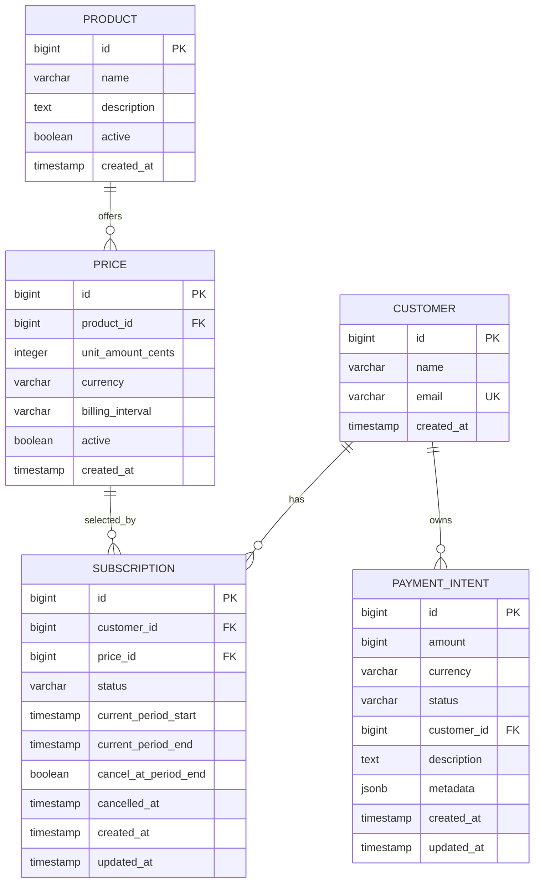

# Billing Platform API

A Stripe-inspired billing backend built with Spring Boot and PostgreSQL. It
exposes REST endpoints for customers, products, prices, subscriptions, and
payment intents, with Flyway-managed schema migrations and validation through
Spring Data JPA.

## Features

- Create, list, retrieve, and delete customers
- Keep customer email addresses normalised and unique
- Create and retrieve billing products
- List and retrieve seeded monthly, yearly, and one-time prices
- Create subscriptions from recurring prices only
- Prevent a customer from having more than one non-cancelled subscription
- Cancel existing subscriptions
- Create, retrieve, list, confirm, and cancel payment intents
- Store payment intent metadata as PostgreSQL `jsonb`
- Block customer deletion when payment intents already reference that customer
- Validate and version the database schema with Flyway
- Provide API connectivity and actuator health endpoints
- Support browser clients through configured CORS origins

## Technology

- Java 21
- Spring Boot 3.5.11
- Spring Web
- Spring Data JPA
- Spring Data Redis dependency
- Spring Boot Actuator
- Jakarta Bean Validation
- PostgreSQL
- Flyway
- Maven Wrapper
- Docker

## Project Structure

```text
src/main/java/com/nikitsya/billing/
|-- common/             # Shared API response types
|-- config/             # Web and CORS configuration
|-- customer/           # Customer API, model, and repository
|-- payment_intent/     # Payment intent API, model, and repository
|-- ping/               # Connectivity endpoint
|-- price/              # Price API, model, and repository
|-- product/            # Product API, model, and repository
`-- subscription/       # Subscription API, model, and repository

src/main/resources/
|-- application.properties
`-- db/migration/       # Flyway database migrations
```

## Prerequisites

- JDK 21 or later
- Docker, or a locally available PostgreSQL instance

Maven does not need to be installed because the repository includes the Maven
Wrapper.

## Configuration

The application reads its runtime configuration from environment variables:

| Variable | Required | Default | Description |
| --- | --- | --- | --- |
| `DB_URL` | Yes | None | PostgreSQL JDBC connection URL |
| `DB_USERNAME` | Yes | None | PostgreSQL username |
| `DB_PASSWORD` | Yes | None | PostgreSQL password |
| `PORT` | No | `8080` | HTTP server port |

Example:

```bash
export DB_URL='jdbc:postgresql://localhost:5432/billing'
export DB_USERNAME='billing'
export DB_PASSWORD='billing'
export PORT='8080'
```

Do not commit production credentials to the repository.

## Running Locally

### 1. Start PostgreSQL

```bash
docker run --name billing-postgres \
  -e POSTGRES_DB=billing \
  -e POSTGRES_USER=billing \
  -e POSTGRES_PASSWORD=billing \
  -p 5432:5432 \
  -d postgres:17
```

If the container already exists, start it instead:

```bash
docker start billing-postgres
```

### 2. Configure the application

```bash
export DB_URL='jdbc:postgresql://localhost:5432/billing'
export DB_USERNAME='billing'
export DB_PASSWORD='billing'
```

### 3. Start the API

```bash
./mvnw spring-boot:run
```

The API is available at `http://localhost:8080`.

Check that it is running:

```bash
curl http://localhost:8080/api/v1/ping
```

Expected response:

```text
ok
```

> **Development seed note:** `V6__insert_sample_subscriptions.sql` references
> customers by email. A completely empty database needs matching customer seed
> rows before that migration can insert the sample subscriptions.

## Running with Docker

Build the image:

```bash
docker build -t billing-platform-api .
```

Run it against the PostgreSQL container:

```bash
docker run --rm \
  --name billing-platform-api \
  --link billing-postgres:postgres \
  -p 10000:10000 \
  -e PORT=10000 \
  -e DB_URL='jdbc:postgresql://postgres:5432/billing' \
  -e DB_USERNAME='billing' \
  -e DB_PASSWORD='billing' \
  billing-platform-api
```

The containerised API is then available at `http://localhost:10000`.

## API Reference

All business endpoints use the `/api/v1` prefix.

| Method | Endpoint | Description | Successful status |
| --- | --- | --- | --- |
| `GET` | `/api/v1/ping` | Check API connectivity | `200 OK` |
| `POST` | `/api/v1/customers` | Create a customer | `201 Created` |
| `GET` | `/api/v1/customers` | List all customers | `200 OK` |
| `GET` | `/api/v1/customers/{id}` | Retrieve a customer | `200 OK` |
| `DELETE` | `/api/v1/customers/{id}` | Delete a customer | `204 No Content` |
| `POST` | `/api/v1/products` | Create a product | `201 Created` |
| `GET` | `/api/v1/products` | List all products | `200 OK` |
| `GET` | `/api/v1/products/{id}` | Retrieve a product | `200 OK` |
| `GET` | `/api/v1/prices` | List all prices | `200 OK` |
| `GET` | `/api/v1/prices/{id}` | Retrieve a price | `200 OK` |
| `POST` | `/api/v1/subscriptions` | Create a subscription | `201 Created` |
| `GET` | `/api/v1/subscriptions` | List all subscriptions | `200 OK` |
| `POST` | `/api/v1/subscriptions/{id}/cancel` | Cancel a subscription | `200 OK` |
| `POST` | `/api/v1/payment_intents` | Create a payment intent | `201 Created` |
| `GET` | `/api/v1/payment_intents` | List all payment intents | `200 OK` |
| `GET` | `/api/v1/payment_intents/{id}` | Retrieve a payment intent | `200 OK` |
| `POST` | `/api/v1/payment_intents/{id}/confirm` | Move a payment intent to processing | `200 OK` |
| `POST` | `/api/v1/payment_intents/{id}/cancel` | Cancel a payment intent | `200 OK` |
| `GET` | `/actuator/health` | Check application health | `200 OK` |

Error responses use a shared shape:

```json
{
  "code": "CUSTOMER_NOT_FOUND",
  "message": "Customer with id 1 was not found"
}
```

## Examples

### Create a Customer

```bash
curl -i -X POST http://localhost:8080/api/v1/customers \
  -H 'Content-Type: application/json' \
  -d '{
    "name": "Ada Lovelace",
    "email": "ada@example.com"
  }'
```

The name must not be blank and the email must be valid. Email addresses are
stored in lower case and must be unique. A duplicate email returns
`409 Conflict`.

Example response:

```json
{
  "id": 1,
  "name": "Ada Lovelace",
  "email": "ada@example.com",
  "createdAt": "2026-07-19T10:30:00"
}
```

### Create a Product

```bash
curl -i -X POST http://localhost:8080/api/v1/products \
  -H 'Content-Type: application/json' \
  -d '{
    "name": "Team Plan",
    "description": "Recurring plan for small teams"
  }'
```

New products are always marked as active by the API.

### List Prices

```bash
curl http://localhost:8080/api/v1/prices
```

Prices are stored in the smallest currency unit. For example,
`unitAmountCents: 999` with `currency: "EUR"` represents EUR 9.99.

Supported billing intervals are:

- `MONTHLY`
- `YEARLY`
- `ONE_TIME`

Price records are currently inserted by Flyway seed data rather than through a
price creation endpoint.

### Create a Subscription

```bash
curl -i -X POST http://localhost:8080/api/v1/subscriptions \
  -H 'Content-Type: application/json' \
  -d '{
    "customerId": 1,
    "priceId": 1
  }'
```

Only `MONTHLY` and `YEARLY` prices can be used for subscriptions. New
subscriptions start immediately with the `ACTIVE` status. Unknown customer or
price identifiers return `404 Not Found`; a one-time price returns
`400 Bad Request`; an existing non-cancelled subscription for the same customer
returns `409 Conflict`.

### Cancel a Subscription

```bash
curl -i -X POST http://localhost:8080/api/v1/subscriptions/1/cancel
```

Cancelling a subscription sets its status to `CANCELLED`. Cancelling an already
cancelled subscription returns `409 Conflict`.

### Create a Payment Intent

```bash
curl -i -X POST http://localhost:8080/api/v1/payment_intents \
  -H 'Content-Type: application/json' \
  -d '{
    "amount": 4999,
    "currency": "eur",
    "customerId": 1,
    "description": "One-time setup fee",
    "metadata": {
      "orderReference": "ORD-1001"
    }
  }'
```

Payment intent amounts are positive values in the smallest currency unit. The
currency is stored in lower case and must be three characters at the database
level. New payment intents start in `REQUIRES_CONFIRMATION`.

### Confirm a Payment Intent

```bash
curl -i -X POST http://localhost:8080/api/v1/payment_intents/1/confirm
```

Only payment intents in `REQUIRES_CONFIRMATION` can be confirmed. Confirmation
moves the status to `PROCESSING`; it does not contact a payment provider.

### Cancel a Payment Intent

```bash
curl -i -X POST http://localhost:8080/api/v1/payment_intents/1/cancel
```

Only payment intents in `REQUIRES_CONFIRMATION` can be cancelled. Other statuses
return `409 Conflict`.

## Data Model



Flyway applies migrations automatically when the application starts. Hibernate
uses `validate` mode, so the application checks entity mappings without
modifying the schema.

## Building and Testing

Run the test suite:

```bash
./mvnw test
```

Create the executable JAR:

```bash
./mvnw clean package
```

Run the packaged application:

```bash
java -jar target/billing-platform-0.0.1-SNAPSHOT.jar
```

## CORS

The API accepts browser requests from:

- `http://localhost:5173`
- `http://localhost:63342`
- `http://localhost:63343`
- `https://billing.nikitsya.dev`

Allowed methods are `GET`, `POST`, `DELETE`, and `OPTIONS`.

## Current Scope

This project currently covers catalogue management, recurring subscription
creation and cancellation, and a local payment intent lifecycle suitable for a
billing prototype. It does not yet authenticate API clients, create prices via
the API, issue invoices, process real payments through an external provider, or
move payment intents automatically from `PROCESSING` to a terminal status.

## Project Assistant

`POST /api/v1/project-assistant/messages` answers questions about this
project using the OpenAI Responses API, GitHub source files and dated
project notes. The frontend's sixth section is its browser client. It can
explain the code but cannot read live billing records or perform billing
actions.

Configure these environment variables on the API server (for example, in the
Render service's Environment settings), then deploy the backend and
frontend:

| Variable | Default | Description |
| --- | --- | --- |
| `OPENAI_API_KEY` | Empty | A project API key from the organisation holding your API credits |
| `OPENAI_MODEL` | `gpt-5.4-mini-2026-03-17` | Responses model supporting `reasoning.effort: none` |
| `AI_REQUESTS_PER_MINUTE` | `10` | Global request allowance per UTC minute |
| `AI_REQUESTS_PER_DAY` | `100` | Global request allowance per UTC day |
| `AI_REQUESTS_PER_MONTH` | `500` | Global request allowance per UTC calendar month |

Keep the API key out of Git, the frontend and logs. An absent key disables
answers with `503 ASSISTANT_UNAVAILABLE`; other billing endpoints still
work. Use a dedicated OpenAI project to distinguish this site's usage.
Eligible ChatGPT subscription API credits must be linked to the key's
organisation; see [OpenAI's credit
guide](https://developers.openai.com/api/docs/guides/chatgpt-api-credits).
The first grant may be prorated, and unused subscription credits expire.

The server accepts at most nine alternating user/assistant messages,
beginning and ending with a user. User messages have a 2,000-character
limit, assistant messages an 8,000-character limit, and the entire
conversation a 12,000-character limit. Bodies over 64 KiB are rejected
before JSON parsing. Only these roles and text content are forwarded. The
model is configured on the server; callers cannot choose a model, tools or
system instructions.

```json
{
  "messages": [
    {"role": "user", "content": "How is the project architected?"}
  ]
}
```

A successful response contains an `answer` string and a `sources` array of
server-generated `{label, url}` links to the files read, pinned to commit
SHAs. Validation errors return 400/413, exhausted local allowances return
429, and provider/configuration failures return 502/503 with safe error
messages. The provider connection has a five-second connect timeout and a
thirty-second timeout per model call. Calls are not retried automatically
and output is capped at 1,200 tokens. Incomplete or empty provider replies
are treated as failures.

### Allowances and cost

Flyway migration V10 creates a single usage-counter row in PostgreSQL. The
quota transaction locks this row and commits a reservation before a paid
answer (at most two model calls). All API instances share these counters;
restarting the service does not reset them. Failed provider attempts consume
a reservation too. If the counter store is unavailable, the request fails
without contacting OpenAI or GitHub. Set any request allowance to zero to
disable calls.

These are request ceilings, not a guaranteed dollar budget. Actual cost
varies with model, input and output; check [current model
pricing](https://developers.openai.com/api/docs/models/gpt-5.4-mini) and the
OpenAI usage dashboard before raising them. The UTC calendar-month counter
may reset on a different day from subscription credits. The public endpoint
has no sign-in: a visitor can exhaust the shared allowance. CORS does not
prevent non-browser use. Provider-side credit settings and, if traffic
warrants it, an edge rate limiter or challenge provide further controls. Do
not rely on an OpenAI project budget alert as a hard spend cap.

### Knowledge and privacy

The assistant reads the default branches of these two public repositories
only:

- `nikitsya/Billing-Platform-API`
- `nikitsya/Billing-Platform-Frontend`

On the first question, the server fetches their latest commit IDs and file
trees. The catalogue is cached for one hour per API instance. The model
selects up to three source files; the server reads them at those exact
commits and supplies up to 12,000 characters per file, marking truncated
excerpts. It then requests the answer with further tool use disabled. File
content is cached with the catalogue. Repository updates become visible
after cache expiry. Local or unmerged branch changes are not part of the
GitHub source context.

Only code, migration SQL, page HTML, stylesheets and selected root
documentation are available. Hidden files, credentials, environment files,
configuration properties, binaries and arbitrary URLs are excluded. Access
is read-only and uses public GitHub endpoints without a token. GitHub errors
or rate limits produce an unavailable response; failed catalogue refreshes
have a one-minute cooldown. GitHub calls have five-second timeouts and no
automatic retries. The maximum normal external wait is about 95 seconds
before cold-start delays; the browser stops waiting after two minutes. This
is deliberately bounded retrieval, not exhaustive analysis of every file for
every question.

Maintain `src/main/resources/assistant/project-notes.txt` alongside code
changes. It includes source paths, the implemented architecture and explicit
limitations, including the absence of real payment processing. The notes are
secondary context; retrieved code takes precedence if revisions differ.
There is no vector database. The model is instructed to distinguish facts
from suggestions and to say when the notes do not establish an answer. AI
output still needs checking.

The application does not persist or log conversation text. The browser sends
recent history on each turn, and `store: false` is sent to OpenAI. This does
not override the provider's own retention policies. Only aggregate request
counts are stored in the database; no IP addresses or visitor identifiers
are recorded by this feature.

The assistant tests use mocked OpenAI and GitHub responses and an isolated
H2 database for quota transaction tests. They make no paid API calls. Run
`./mvnw test`. A real-provider smoke test is still needed after the server
key is set.
